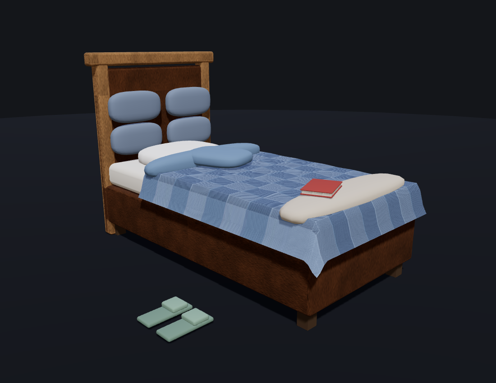
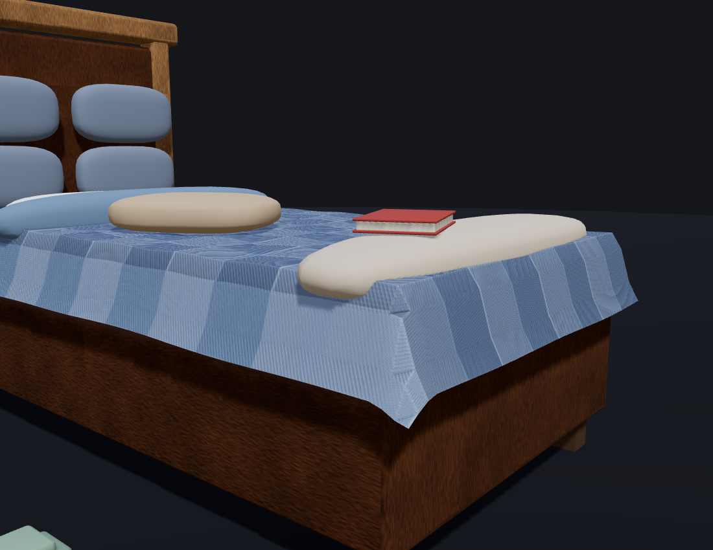
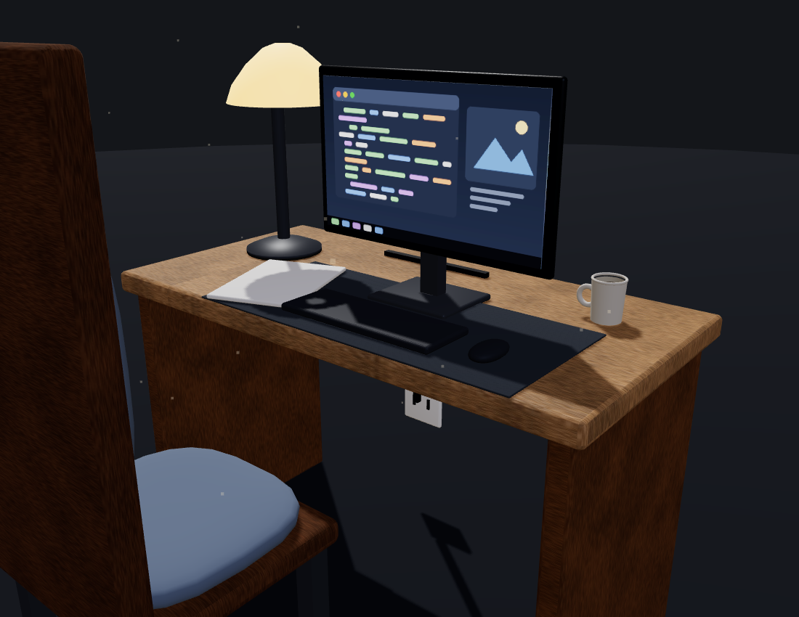
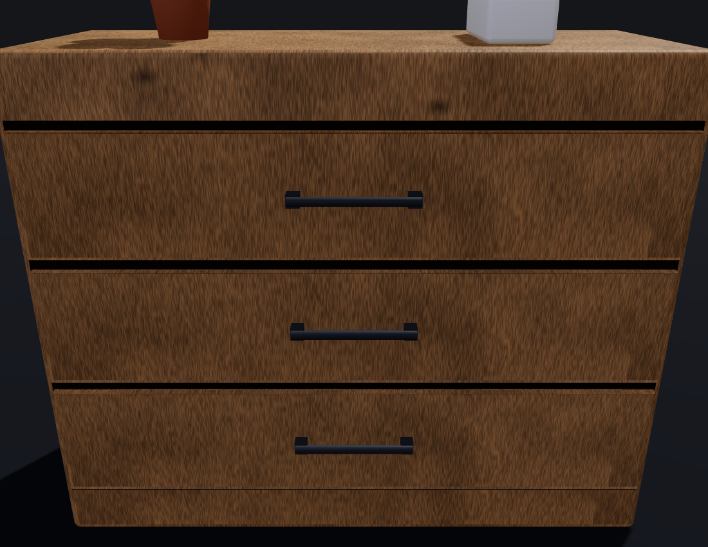
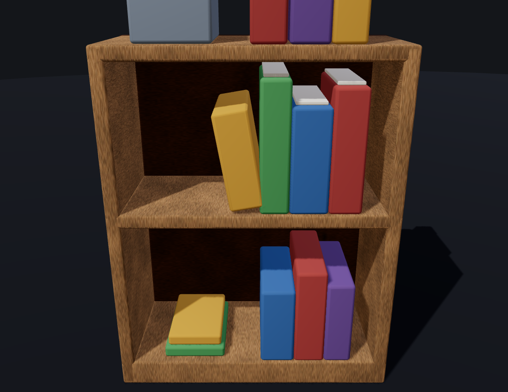
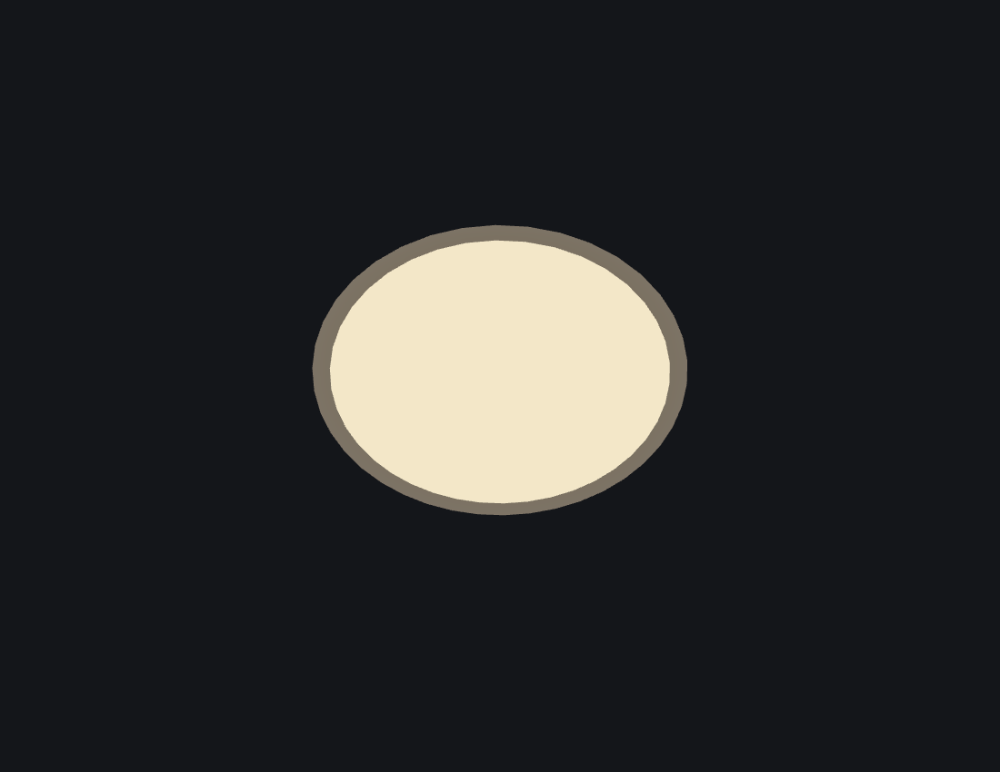

# 家具カタログ

XRiftワールド「六畳の寝室（夜）」（v21）で作った家具の部品集。
1点ずつ名前を付け、コンポーネント単体の `.tsx` として置いてある。
画像はすべて「家具ラボ」（単体確認用のViewer）で描画した実物。

共通部品は [parts.tsx](./parts.tsx)（`Box` = 角丸対応の箱、`Puff` = 超楕円体の柔らかい塊、`DrapeBlanket` = 縁が垂れる掛け布団、`TissueSheet` ほか）。
各家具は `parts.tsx` に依存するので、使うときは一緒に持っていく。

テクスチャはワールド側の `public/`（floor-wood.jpg など）を `TexSet` として props で渡す前提。

| 名前 | ファイル | 画像 |
|---|---|---|
| シングルベッドセット | [bed-set.tsx](./bed-set.tsx) | [全体](./assets/bed.png) / [布団の垂れ](./assets/bed-drape.png) |
| 学習デスクセット | [desk-set.tsx](./desk-set.tsx) | [desk.png](./assets/desk.png) |
| 3段チェスト | [chest-set.tsx](./chest-set.tsx) | [chest.png](./assets/chest.png) |
| 本棚 | [shelf-set.tsx](./shelf-set.tsx) | [shelf.png](./assets/shelf.png) |
| ドーム型シーリングライト | [ceiling-light.tsx](./ceiling-light.tsx) | [ceiling.png](./assets/ceiling.png) |

## シングルベッドセット（BedSet）

掛け布団は格子メッシュで縁が垂れる `DrapeBlanket`。ヘッドボードのパッドは超楕円体 `Puff` の4分割クッション。枕・飾りクッション・スローも `Puff`。文庫本とスリッパ付き。

## 学習デスクセット（DeskSet）

デスク＋モニター＋キーボード＋マウス（`Puff` のドーム型）。椅子は公式 `Seat` で座面・背もたれがクッション。デスクランプは Lathe のベル型シェードで `Interactable`（ON/OFF連動）。マグカップは持ち運びアイテム版と同じ構造（取っ手＋コーヒー面）。

## 3段チェスト（ChestSet）

引き出し3段にバーハンドル。前板と本体の隙間は8mm。上の観葉植物の鉢は Lathe 回転体、ティッシュは波打ち平面。

## 本棚（ShelfSet）

2段。立てた本（上面にクリーム色のページ面）、寄りかかる本、平積み、小物箱。

## ドーム型シーリングライト（CeilingLight）

Lathe 回転体のドーム＋発光円盤。`ceilingOn` props で点灯/消灯（発光の強さが連動）。
